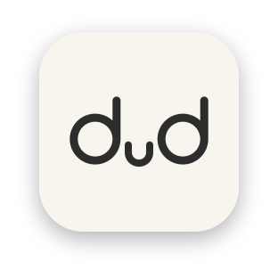
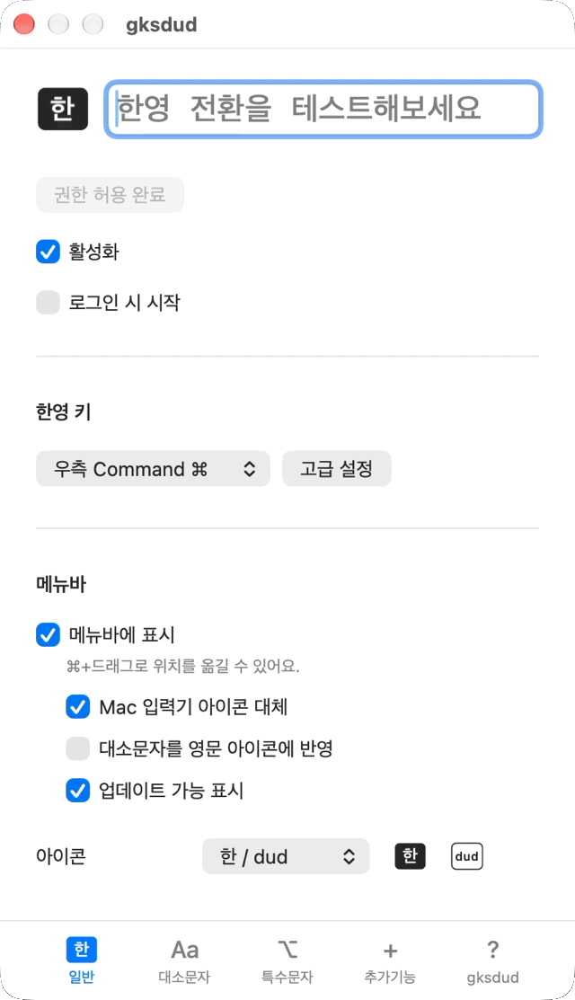
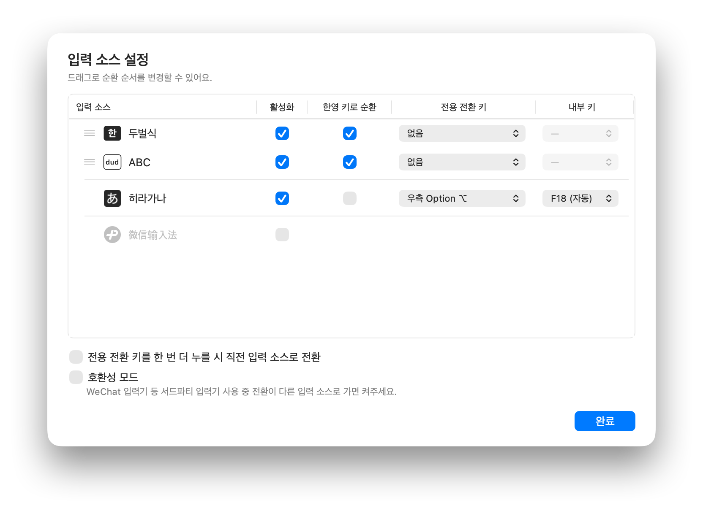

<div align="center">



# gksdud

**씹힘 없고 빠릿빠릿한 Mac 한영 전환**

`Karabiner`도, 복잡한 설정도 없이 앱 하나로

[](https://gksdud.noye.dev) [](#a-homebrew로-설치)

[](https://github.com/codingnoye/gksdud/releases/latest) [](LICENSE) [](https://fairy.hada.io/@gksdud)

</div>

## 주요 기능

- **클릭 한 번으로 한영 키 설정**: `⌘`, `⌥`, `Caps Lock`, `⌃/⌘/⌥/⇧ + Space` 등 편한 키를 한영 키로 쉽게 설정
- **빠릿빠릿한 한영 전환**: 씹히지 않는 한영 전환
- **다른 언어도 '딸깍'**: 중국어, 일본어 등도 한영 키로 순환하거나, 원한다면 **별도 키**로 바로 전환해요
- **한영 전환이 끝이 아니에요**: 대소문자, 특수문자, 키보드별 설정 등 맥 입력기의 여러 불편한 점을 고쳐요
- **스크립팅/AI친화**: Hammerspoon, Raycast, 스크립트에서 설정을 바꾸고, 일시정지하고, 입력 소스를 전환하세요. AI에게 `gksdud cli 이용해서, Ghostty 켜면 영어로 전환되게 해줘.`라고 해보세요.

## 기능 소개

### 한영 키와 빠른 전환



잠깐만 써봐도 체감될 만큼 빠릿빠릿하게 한영 전환됩니다.
- **한영 키 변경**: `우측 ⌘` 등의 키를 선택해 한영 키로 사용
  - 키보드마다 한영 키를 따로 정하거나 끌 수 있어요
- **딜레이, 키 씹힘 개선**: 기존 방법들의 **딜레이**, **글자 씹힘**, **전환 씹힘** 없는 전환 구현

### 길게 눌러 대소문자 전환


새로운 방식의, 한영전환 딜레이 없는 꾹 눌러 대소전환 기능입니다.
- **한영키 길게 눌러 대소문자 전환**: 기존 방식과 다르게 누를때 즉시 한영 전환된 후, 길게 유지한다면 대소문자 변환하는 방식으로 **딜레이 없음**
- **한영 전환 대소문자 보존**: 영문 대문자 상태에서 한글로 전환해도 영어로 돌아오면 대문자 유지

### 메뉴바


기존 메뉴바의 입력기 아이콘을 대체해 공간을 절약합니다. 아이콘도 바꿀 수 있어요.

### 다국어 설정



- **다국어 지원**: 중국어, 일본어 등 다른 입력 소스도 전환 가능
- **전환키 분리 설정**: 한영 키로 같이 순회하거나, 언어별 전용 키로 전환 설정 가능

### 그 외

- **특수문자 입력**: 한글 상태에서도 `⌥+문자` 특수문자를 영어처럼 입력하거나, Option 문자 입력을 비활성화
- **₩와 `` ` `` 반전**: 한글 상태에서도 영어처럼 ₩ 대신 `` ` ``를 입력하고, `⌥+₩`로 ₩를 입력
- **유니버설 컨트롤 호환**: 유니버설 컨트롤로 다른 Mac의 키보드를 쓸 때도 한영 전환
- **CLI**: Hammerspoon 등에서 설정 변경, 일시정지, 입력 소스 전환 ([CLI 문서](docs/cli.md))
- 그 외에도 맥 입력기의 불편한 점들을 개선하기 위한 다양한 기능을 제공합니다!

## 설치

### A. Homebrew로 설치

```sh
brew install --cask codingnoye/tap/gksdud
```

### B. 직접 설치

1. [다운로드 페이지](https://gksdud.noye.dev) 또는 [릴리즈 페이지](https://github.com/codingnoye/gksdud/releases/latest)에서 `gksdud-<버전명>.dmg` 파일을 내려받습니다.
2. DMG를 열고 gksdud를 **Applications**로 끌어옮깁니다.
3. gksdud를 실행합니다.

## 사용하기

1. `gksdud` 앱을 실행하면 메뉴 바에 아이콘이 표시됩니다.
   1. 기존 입력기 아이콘과 유사한 아이콘을 찾아보세요.
   2. `⌘+드래그`로 위치를 옮길 수 있습니다.
2. **접근성 권한 허용** 후 **활성화**합니다.
3. 상단 입력창에서 한글과 영어를 번갈아 입력하며 테스트해보세요.

## 어떻게 동작하나요?

- **한영 키를 F19로 바꿉니다.** macOS의 키 매핑 기능으로, 선택한 한영 키를 `F19`(기본값)에 연결하고 시스템의 `이전 입력 소스 선택` 단축키도 `F19`로 맞춥니다. 이를 통해 `Caps Lock` 기반 전환의 딜레이를 줄일 수 있습니다. 여기까지는 기존의 `Karabiner`+수동 시스템 설정 방법과 동일합니다.
- **누르자마자 전환합니다.** 한영 키를 누르는 순간 `F19` 키의 누름과 뗌 이벤트를 연달아 발생시킵니다. 빠르게 입력 중 전환 시 한 글자씩 씹히던 문제를 개선합니다.
- **간단한 구현.** 입력 소스를 직접 바꾸거나 입력기를 바꾸지 않습니다. 설정이 꼬이는 문제가 적도록 단순히 키 매핑과 전환 이벤트만으로 동작하게 구현되었습니다.

## 기여

개발 환경과 빌드, 검증 방법은 [기여 안내](CONTRIBUTING.md)를 참고하세요.

## 후원

[Fairy](https://fairy.hada.io/@gksdud)에서 프로젝트를 후원해주실 수 있습니다. 프로젝트를 유지하는 데 큰 도움이 됩니다.

많은 분들의 후원해주신 덕분에 애플 인증서로 서명해 배포할 수 있었습니다.
응원과 지원해주신 모든 분들께 감사드립니다!

## 라이선스

[MIT](LICENSE) ,  © 2026 CodingNoye ,  codingnoye@gmail.com
